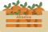

<p align="center">
  
</p>

# Abuelos

A mobile e-commerce app (Ionic/Angular) for selling fruit directly from farmers to consumers, through local relay buyers called "repartidores".

## What it does

- **Catalogue and basket**: browse products, view a product page, add products to a basket and update quantities.
- **Roles**: user, farmer, seller and admin. Farmers add their fields (photo, name, description) and their products, each product linked to a field; fields can be edited or deleted.
- **Repartidor programme**: a consumer who orders 16 crates or more can apply to become a repartidor, a local relay who receives deliveries and redistributes them to people nearby. The app explains the concept, how ordering works and the repartidor scheme, and includes the application form.
- **Messaging**: search for users and chat with them; messages update in real time with Firestore.
- **Account**: sign up, log in, profile and avatar upload, dashboard, orders and settings pages.

## Tech stack

Ionic 7, Angular 17, TypeScript, Capacitor 5 (Android and iOS), Firebase (Authentication, Firestore, Storage). Products, baskets and users are also served by a separate REST API (expected on `http://localhost:3001`) that is not part of this repository.

## Run it locally

```bash
npm install
npx ionic serve
```

Most screens need the companion REST API running on port 3001 to show data.

## Context

Built by Marius Diguat--Mateus as a freelance project between January and April 2024, for a client running a direct-sale fruit business inspired by natural farming. The app was a work in progress when development stopped.
